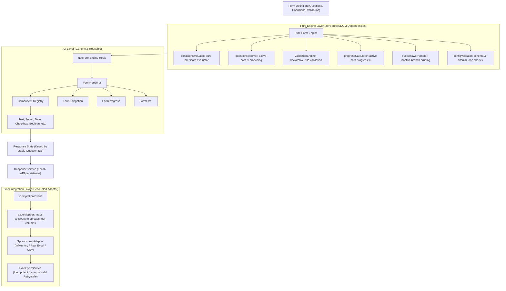

# Interactive Dynamic Form System — Implementation Documentation

## 1. Executive Summary & Core Principle

The **Interactive Dynamic Form System** is a configuration-driven runtime engine. The frontend does not contain form-specific or question-specific pages, components, or hardcoded branching logic.

### The Governing Principle

> **Content defines WHAT is asked** (Configuration)  
> **Form Engine defines HOW it flows** (Pure Logic)  
> **UI defines HOW it looks** (Reusable Component Registry)  
> **Persistence & Integration defines WHERE responses go** (Isolated Adapters)

Whether a form has 5 questions or 100 questions, the codebase uses the **exact same engine, renderer, state model, and components**. Adding new questions or modifying existing branches is done through declarative configuration without writing new React components.

---

## 2. System Architecture



---

## 3. Layer-by-Layer Implementation Breakdown

### 3.1 Type Definitions (`src/types/`)

All domain models are strongly typed with strict TypeScript and zero `any` usage:

| File | Purpose | Key Types |
| :--- | :--- | :--- |
| `form.types.ts` | Form and question specifications | `FormDefinition`, `QuestionDefinition`, `QuestionType`, `QuestionOption`, `NavigationRule` |
| `condition.types.ts` | Declarative conditions and operators | `Condition`, `SimpleCondition`, `CompoundCondition`, `ConditionOperator` |
| `validation.types.ts` | Validation contracts | `ValidationRule`, `ValidationResult`, `ValidationError` |
| `response.types.ts` | Response envelope and lifecycle | `FormResponse`, `ResponseStatus`, `sync` metadata |
| `excel.types.ts` | Spreadsheet adapter contracts | `SpreadsheetRow`, `SpreadsheetAdapter`, `ExcelColumnMapping` |

---

### 3.2 Pure Form Engine (`src/forms/engine/`)

Every engine module is implemented as a **pure function**, independent of React, DOM, or network APIs. This guarantees testability, determinism, and performance.

#### `conditionEvaluator.ts`
Evaluates conditions against the current answers dictionary.
- **Operators**: `equals`, `notEquals`, `contains`, `notContains`, `greaterThan`, `greaterThanOrEqual`, `lessThan`, `lessThanOrEqual`, `in`, `notIn`, `isEmpty`, `isNotEmpty`.
- **Compound logic**:
  - `all`: Logical AND (all sub-conditions must match).
  - `any`: Logical OR (at least one sub-condition must match).
  - `not`: Logical NOT (inverts evaluation).

```ts
// Example declarative condition:
{
  any: [
    { questionId: "customer_type", operator: "equals", value: "business" },
    { questionId: "annual_revenue", operator: "greaterThan", value: 500000 }
  ]
}
```

#### `questionResolver.ts`
Determines which questions are applicable and what question to show next:
- `getActiveQuestions(form, answers)`: Evaluates `question.visibility` condition for each question, returning only active questions.
- `resolveNextQuestion({ form, currentQuestionId, answers })`: Checks explicit `question.next` rules first (with conditional `when`), then falls back to sequential order along active questions. Returns `null` on terminal completion.
- `resolvePreviousQuestion({ form, currentQuestionId, answers, visitedHistory })`: Resolves backwards navigation using navigation history or active question precedence.

#### `validationEngine.ts`
Centralizes validation logic before progressing to next steps:
- Evaluates `required`, `minLength`, `maxLength`, `min`, `max`, `email`, `pattern` (regex), and `custom` (pure predicate).
- Evaluates individual questions (`validateQuestion`) or all active questions on submit (`validateActiveQuestions`).

#### `progressCalculator.ts`
Computes progress strictly based on the **active question path**:
$$\text{Progress} = \frac{\text{Answered Active Questions}}{\text{Total Applicable Active Questions}} \times 100\%$$
If a form has 20 configured questions, but based on branch rules only 5 apply to this user, answering 2 questions yields **40% progress** ($2/5$), never $10\%$ ($2/20$).

#### `staleAnswerHandler.ts`
Enforces the **Stale Answer Rule**:
When a user navigates backwards and changes an upstream answer (e.g., switches `customer_type` from `business` to `individual`), questions on the business branch disappear. `cleanupStaleAnswers` immediately strips answers belonging to now-hidden questions, preventing invalid or contradictory data from leaking into final submissions or Excel exports. Handles multi-level cascading dependencies iteratively.

#### `configValidator.ts`
Validates form definitions at build/runtime:
- Detects duplicate question IDs.
- Validates question types and required options.
- Verifies that visibility conditions reference real questions in the same form.
- Catches self-referencing dependencies and circular navigation loops.

---

### 3.3 Reusable Component Registry & UI (`src/components/`)

#### The Component Registry (`src/components/form/componentRegistry.ts`)
Maps question interaction types directly to reusable components:

```ts
export const questionComponentRegistry: Record<QuestionType, React.ComponentType<QuestionProps<never>>> = {
  text: TextQuestion,
  textarea: TextareaQuestion,
  number: NumberQuestion,
  email: EmailQuestion,
  singleSelect: SingleSelectQuestion,
  multiSelect: MultiSelectQuestion,
  dropdown: DropdownQuestion,
  date: DateQuestion,
  boolean: BooleanQuestion,
};
```

#### Reusable Question Inputs (`src/components/questions/`)
- `TextQuestion`: Accessible text input with `aria-invalid`, `aria-describedby`.
- `TextareaQuestion`: Multiline input with accessible character guidelines.
- `NumberQuestion`: Numeric input with min/max validation constraints.
- `EmailQuestion`: Native email input with `inputMode="email"`, auto-capitalize disabled.
- `SingleSelectQuestion`: Interactive card selection with semantic `role="radiogroup"` and keyboard focus.
- `MultiSelectQuestion`: Interactive multi-select cards with `role="group"`.
- `DropdownQuestion`: Accessible `<select>` element.
- `DateQuestion`: Native HTML5 date picker.
- `BooleanQuestion`: Yes / No selection group with active state tracking.

#### Container Components (`src/components/form/`)
- `FormRenderer.tsx`: Main entry point. Assembles header, progress bar, active question, error banner, and navigation buttons.
- `FormNavigation.tsx`: Handles `Previous`, `Next`, and `Submit` actions with keyboard shortcuts (Enter to advance).
- `FormProgress.tsx`: Accessible progress indicator (`role="progressbar"`).
- `FormCompleted.tsx`: Displays submission confirmation, response ID, Excel sync status, retry trigger, answer summary, and CSV export.
- `FormError.tsx`: Accessible error banner with retry/dismiss actions.

---

### 3.4 Response Persistence & Excel Integration (`src/services/`)

The architecture cleanly decouples response persistence from spreadsheet synchronization:

```
Submit Form
    ↓
1. ResponseService.saveResponse() → Persisted as COMPLETED
    ↓
2. ExcelSyncService.syncResponse() → Attempt Spreadsheet Sync
    ├── SUCCESS → Response status updated to SYNCED
    └── FAILURE → Response status updated to SYNC_FAILED (Data is preserved!)
```

#### `responseService.ts`
Authoritative repository for form responses. Stores complete response envelopes with timestamps and sync metadata. Implements caching and local persistence.

#### `excelMapper.ts`
Pure function `mapResponseToSpreadsheetRow(form, response)`:
- Maps responses into column rows using `form.excelMapping` or question labels.
- Standard metadata columns: `Response ID`, `Form ID`, `Form Version`, `Submitted At`, `Status`.
- Formats arrays (comma-separated), booleans (Yes/No), and nulls (`""`).

#### `excelAdapter.ts`
Defines `SpreadsheetAdapter` interface and `InMemoryExcelAdapter`:
- `appendRow(row)`
- `updateRow(identifierKey, identifierValue, row)`
- `findRow(identifierKey, identifierValue)`
- `getAllRows()`
- Outage simulation toggle for resilience testing.
- `toCsv()` export functionality.

#### `excelSyncService.ts`
- **Strict Idempotency**: Before appending, checks if a row with `Response ID` already exists. If found, updates it in-place. Duplicate submissions or retries will **never create duplicate spreadsheet rows**.
- **Failure Tolerance**: If spreadsheet writing fails, the user's completed response is safe. The status becomes `SYNC_FAILED`, and the user or background job can call `retrySync()` when connectivity is restored.

---

## 4. How to Add a New Question

In 99% of cases, adding a question requires **configuration only**:

```ts
// In your form definition file:
{
  id: "referral_source",
  type: "singleSelect",
  label: "How did you hear about us?",
  required: true,
  options: [
    { value: "search", label: "Search Engine" },
    { value: "social", label: "Social Media" },
    { value: "friend", label: "Friend or Colleague" },
    { value: "other", label: "Other" }
  ],
  visibility: {
    questionId: "customer_type",
    operator: "equals",
    value: "individual"
  }
}
```

No React components, no JSX, no CSS, and no new API hooks need to be created.

---

## 5. How to Create a New Form

1. Create a definition file in `src/forms/definitions/myNewForm.ts`:

```ts
import type { FormDefinition } from '../../types/form.types.ts';

export const myNewForm: FormDefinition = {
  id: 'event-feedback',
  version: 1,
  title: 'Event Feedback Survey',
  description: 'Tell us about your experience.',
  status: 'PUBLISHED',
  excelMapping: {
    attended: 'Attended In Person',
    rating: 'Event Rating',
    feedback: 'Detailed Comments',
  },
  questions: [
    {
      id: 'attended',
      type: 'boolean',
      label: 'Did you attend the event in person?',
      required: true,
    },
    {
      id: 'rating',
      type: 'dropdown',
      label: 'Overall Rating',
      required: true,
      options: [
        { value: '5', label: '5 - Excellent' },
        { value: '4', label: '4 - Good' },
        { value: '3', label: '3 - Average' },
      ],
      visibility: {
        questionId: 'attended',
        operator: 'equals',
        value: true,
      },
    },
    {
      id: 'feedback',
      type: 'textarea',
      label: 'Any comments or suggestions?',
    },
  ],
};
```

2. Render it with `<FormRenderer form={myNewForm} />`. The form engine handles all routing, conditions, validation, progress, persistence, and Excel mapping automatically.

---

## 6. Test Suite & Verification

The project includes 24 automated unit and integration tests covering all critical paths:

- **Condition Evaluation**: All simple and compound operators (`equals`, `contains`, `greaterThan`, `in`, `isEmpty`, `all`, `any`, `not`).
- **Validation Engine**: Required rules, length constraints, range limits, email formatting, custom validators.
- **Resolver & Flow**: Active question filtering, forward skipping, backwards navigation.
- **Progress Calculator**: Verification of progress % based strictly on active path count.
- **Stale Answer Cleaner**: Dynamic branch invalidation and cascade purging.
- **Configuration Validator**: Duplicate ID detection, invalid reference catching, loop protection.
- **Excel Mapper**: Column mapping, formatting, and normalization.
- **Idempotency & Outages**: Verifying that repeated sync attempts never duplicate rows, and that network drops preserve response data and allow clean retry.

```bash
# Run unit & integration tests
npm test

# Build production bundle
npm run build

# Check linting & type rules
npm run lint

# Start interactive local development workbench
npm run dev
```

